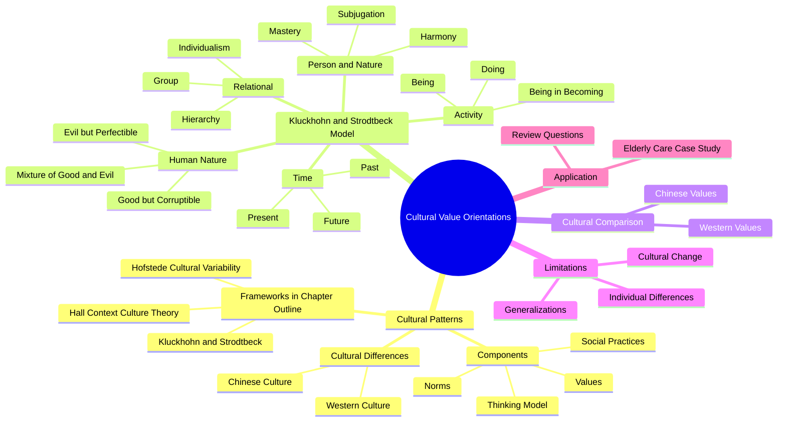
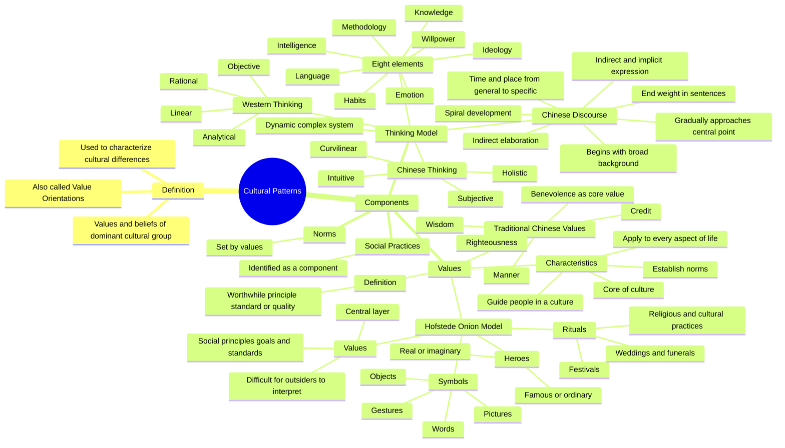
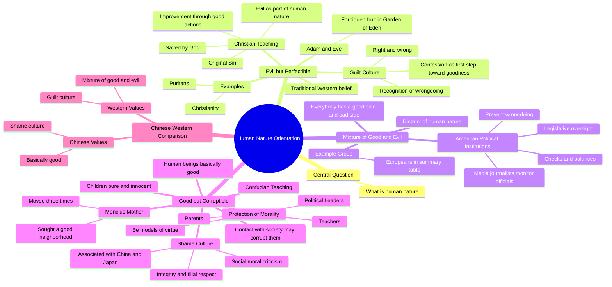
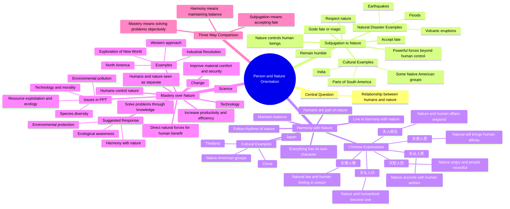
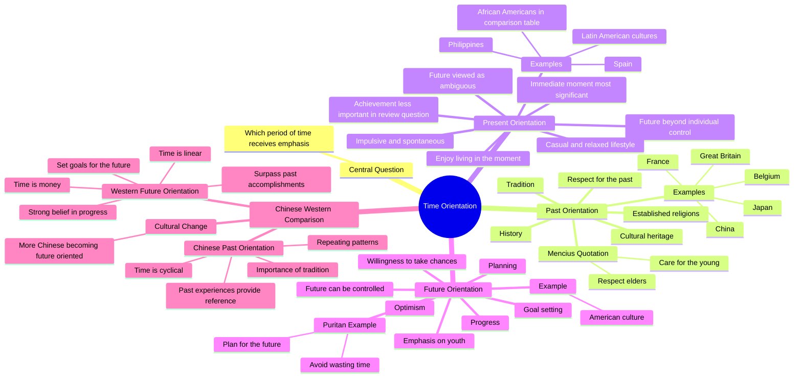
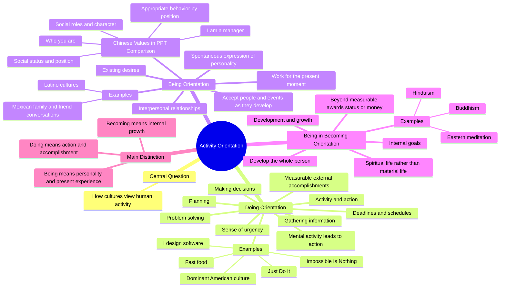
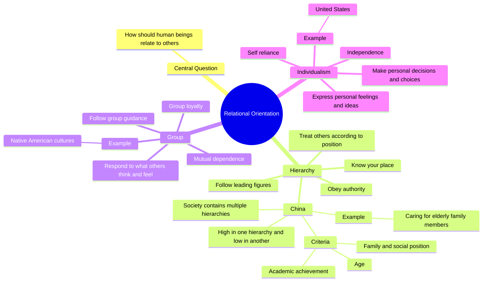
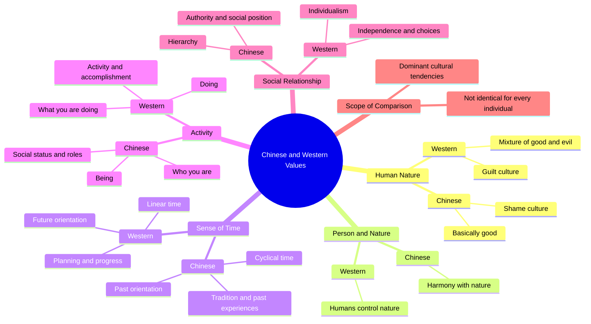
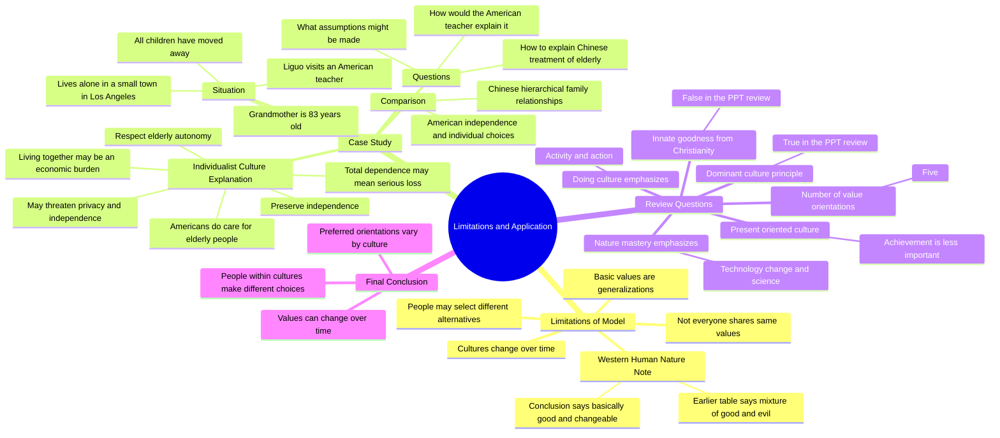

# Chapter 4 — Cultural Value Orientations

> Complete Mermaid mind maps for Obsidian. All substantive knowledge points are drawn from the supplied presentation and the preceding source-based outline. Open in **Reading View** or **Live Preview**.

## 1. Overall Knowledge Framework

## 2. Cultural Patterns and Their Components

## 3. Human Nature Orientation

## 4. Person–Nature Orientation

## 5. Time Orientation

## 6. Activity Orientation

## 7. Relational Orientation

## 8. Chinese–Western Cultural Values

## 9. Limitations, Application and Review

