# 第十三章 热力学基础

#物理/热学

热力学研究宏观物体与系统在**热量传递、做功、内能变化**中的普遍规律。本章可沿着一条主线理解：第一定律回答“能量如何守恒”，第二定律回答“过程能够沿什么方向自发进行”，熵则把过程方向转化为可以计算的状态变化。

> [!important] 全章三个核心问题
> 1. **能量守恒**：吸收的热量去了哪里？——$Q=\Delta U+A$。
> 2. **过程限制**：守恒允许的变化，是否都能自然发生？——热力学第二定律。
> 3. **方向判据**：怎样定量判断不可逆性？——熵与熵增加原理。

## 一、基本概念与热力学第一定律

### 1. 系统、状态与过程

**热力学系统**是选定进行研究的一部分物质或空间；其余部分称为外界。讨论热量与功时，必须首先指定系统边界。根据系统与外界的交换，可区分：

| 系统 | 物质交换 | 能量交换 | 典型说明 |
| --- | --- | --- | --- |
| 开放系统 | 可以 | 可以 | 有物质流入或流出的装置 |
| 封闭系统 | 不可以 | 可以 | 密闭气缸中的气体 |
| 孤立系统 | 不可以 | 不可以 | 理想化的完全隔绝系统 |

一个平衡态可由适当的状态参量描述，例如一定量理想气体的 $p,V,T$。**状态函数**只取决于所处状态，**过程量**则取决于从初态到末态所采取的具体路径。

- $U$：内能，是状态函数；$\Delta U=U_2-U_1$ 与路径无关。
- $Q$：系统在一个过程中交换的热量，是过程量。
- $A$：系统在一个过程中对外界所做的功，也是过程量。

> [!warning] 三个量不可混淆
> 不能说“气体储存了多少热量 $Q$”或者“状态 1 具有多少功 $A$”。系统具有**内能**，而热量和功描述的是**能量传递方式**。

### 2. 能量守恒与符号规定

令 $Q$ 为系统从外界吸收的热量，$A$ 为**系统对外界**所做的功，则

$$
\boxed{Q=\Delta U+A}
$$

等价地，$\Delta U=Q-A$；微小过程对应

$$
\boxed{\mathrm dU=\delta Q-\delta A}
$$

这里采用 $\delta Q,\delta A$ 强调热量与功不是状态函数的全微分；有些课程直接记为 $\mathrm dQ,\mathrm dA$，含义相同。

| 符号 | 正值代表 | 负值代表 |
| --- | --- | --- |
| $Q$ | 系统吸热 | 系统放热 |
| $A$ | 系统对外做功 | 外界对系统做功 |
| $\Delta U$ | 内能增加 | 内能减少 |

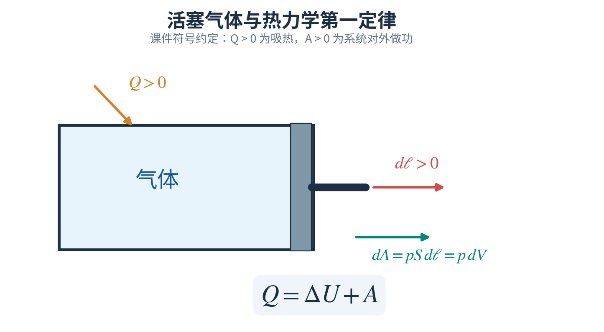

> [!note] 热力学第一定律的物理意义
> 热量和功都能改变系统内能。第一定律是能量守恒在热过程中的表达，它排除了**不消耗能量而不断对外做功的第一类永动机**。

**四个立即可用的特例：**

1. 不对外做功 $A=0$：$Q=\Delta U$。
2. 绝热过程 $Q=0$：$\Delta U=-A$。
3. 内能不变 $\Delta U=0$：$Q=A$。
4. $Q=A=0$：$\Delta U=0$，但不能因此断定温度、压强与体积都不变（对理想气体，只能进一步说温度不变）。

### 3. 准静态过程与可逆过程

**准静态过程**：进行得足够缓慢，使系统在每一时刻都无限接近平衡态，因此中间状态可以用平衡态参量描述，并可在 $p$–$V$ 图中画成连续曲线。

**可逆过程**要求系统与外界都能通过反向过程完全恢复原状，不留下任何净变化。理想的无摩擦、无限缓慢且热交换温差无限小的过程，才有可能可逆。

> [!warning] “慢”与“可逆”不是同义词
> 准静态只描述系统沿途接近平衡；有摩擦、黏滞或有限温差传热时，即使非常缓慢，仍然可能不可逆。**可逆过程通常要求准静态，还要求没有耗散。**

### 4. 准静态体积功与 $p$–$V$ 图

气体通过面积为 $S$ 的活塞施加压强 $p$，活塞移动 $\mathrm d\ell$，体积变化 $\mathrm dV=S\,\mathrm d\ell$，故准静态过程中的微元功为

$$
\delta A=pS\,\mathrm d\ell=p\,\mathrm dV.
$$

从状态 1 到状态 2：

$$
\boxed{A_{1\to2}=\int_{V_1}^{V_2}p\,\mathrm dV}
$$

因此，在 $p$–$V$ 图上，**沿过程曲线到体积轴的有向面积是体积功**：向右膨胀为正，向左压缩为负；竖直等容线的功为零。

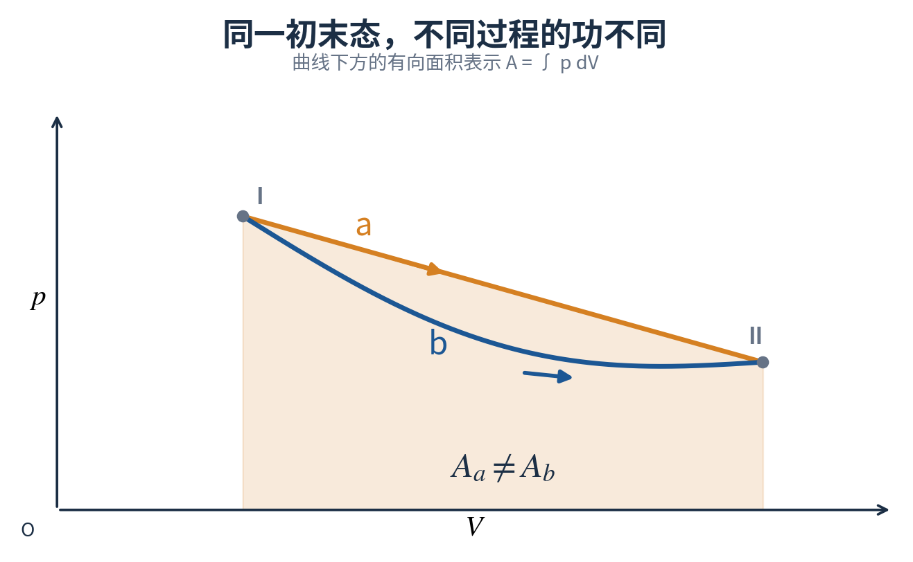

> [!important] 路径与状态的区别
> 即使起点和终点完全相同，不同过程曲线下的面积也可能不同，即 $A_a\ne A_b$；但由于内能是状态函数，$\Delta U_a=\Delta U_b$。于是由第一定律，$Q_a$ 与 $Q_b$ 一般也不同。

> [!example] 例 1：利用过程曲线比较吸放热
> 某气体由 $a$ 到 $c$，沿一条较高压强的等压—等容路径吸收热量 $350\times10^5\,\mathrm J$。图中该路径从 $V=6\,\mathrm{m^3}$ 变到 $12\,\mathrm{m^3}$，做功段压强 $21\times10^5\,\mathrm{Pa}$。
>
> $$A_{ac}=21\times10^5\times(12-6)=126\times10^5\,\mathrm J.$$
>
> 故两状态内能差为
>
> $$U_c-U_a=Q_{ac}-A_{ac}=224\times10^5\,\mathrm J.$$
>
> 如果改走压强 $8\times10^5\,\mathrm{Pa}$ 的等压—等容路径，体积变化相同，则
>
> $$A=8\times10^5(12-6)=48\times10^5\,\mathrm J,$$
>
> $$Q=(U_c-U_a)+A=272\times10^5\,\mathrm J.$$
>
> 可见 **$\Delta U$ 不变，但 $Q$ 与 $A$ 随路径改变**。如果再从 $c$ 返回 $a$，外界对系统做功 $79\times10^5\,\mathrm J$，则 $A=-79\times10^5\,\mathrm J$，$\Delta U=-224\times10^5\,\mathrm J$，由此 $Q=-303\times10^5\,\mathrm J$，系统放热。

## 二、热容、内能与理想气体

### 1. 热容、比热容、摩尔热容

热容描述系统在**指定过程条件下**温度变化与吸放热之间的关系：

$$
C=\frac{\delta Q}{\mathrm dT},\qquad
c=\frac{C}{m},\qquad
C_m=\frac{C}{\nu}.
$$

其中 $m$ 为质量，$\nu=m/M$ 为**物质的量**，$M$ 为摩尔质量。单位依次为 $\mathrm{J/K}$、$\mathrm{J/(kg\cdot K)}$、$\mathrm{J/(mol\cdot K)}$。

若所考察过程中热容恒定，

$$Q=\int_{T_1}^{T_2}C\,\mathrm dT=\nu C_m(T_2-T_1).$$

**注意：**热容依赖过程条件，不能脱离过程直接使用。例如同一理想气体的等容加热和等压加热具有不同的摩尔热容。

### 2. 理想气体内能与自由度

在刚性分子模型和经典能量均分定理的适用范围内，若分子有效自由度为 $i$，则一定量理想气体的内能为

$$
\boxed{U=\frac{i}{2}\nu RT},\qquad
\boxed{\Delta U=\frac{i}{2}\nu R(T_2-T_1)}.
$$

常用刚性分子自由度近似为：单原子 $i=3$，双原子 $i=5$，非直线多原子 $i=6$。这里忽略某些温区的振动激发及量子效应。

> [!important] 焦耳定律（理想气体）
> **理想气体的内能仅是温度的函数**。在上述自由度不变的模型中，$\Delta U=\nu C_{V,m}\Delta T$。因此等温时 $\Delta U=0$，但不能据此认定 $Q=A=0$。

### 3. 定容热容与定压热容

**定容过程**中 $\mathrm dV=0$，气体不做体积功：

$$
\delta Q_V=\mathrm dU,\qquad
\boxed{C_{V,m}=\frac{i}{2}R}.
$$

**定压过程**中吸热同时用于增加内能和对外做功：

$$
\delta Q_p=\mathrm dU+p\,\mathrm dV.
$$

由理想气体方程 $pV=\nu RT$，在定压时 $p\,\mathrm dV=\nu R\,\mathrm dT$，故

$$
\boxed{C_{p,m}=\frac{i+2}{2}R}.
$$

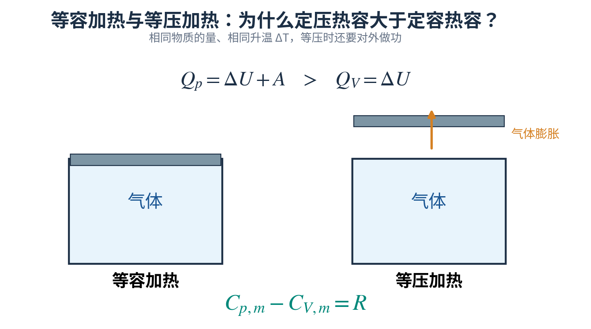

二者相减得到**理想气体迈耶公式**：

$$
\boxed{C_{p,m}-C_{V,m}=R}.
$$

定义**比热容比（绝热指数）**

$$
\boxed{\gamma=\frac{C_{p,m}}{C_{V,m}}=\frac{i+2}{i}>1}.
$$

| 分子类型（刚性近似） | $i$ | $C_{V,m}$ | $C_{p,m}$ | $\gamma$ |
| --- | ---: | ---: | ---: | ---: |
| 单原子 | 3 | $\dfrac32R$ | $\dfrac52R$ | $\dfrac53$ |
| 双原子 | 5 | $\dfrac52R$ | $\dfrac72R$ | $\dfrac75$ |
| 非直线多原子 | 6 | $3R$ | $4R$ | $\dfrac43$ |

> [!tip] 快速记忆与应用
> 对一定量、自由度不变的理想气体，不论经过哪条路径，内能变化都可直接由 $\Delta U=\nu C_{V,m}\Delta T$ 计算；而热量只能在确定路径后，利用 $Q=\Delta U+A$ 求得。

## 三、理想气体的典型准静态过程

对一定量、热容近似恒定的理想气体，状态方程为

$$pV=\nu RT.$$

第一定律统一写成

$$
\boxed{\delta Q=\nu C_{V,m}\,\mathrm dT+p\,\mathrm dV}.
$$

理解以下四种过程，先判断**保持不变的量**，再判断 $A$，最后用第一定律求 $Q$。

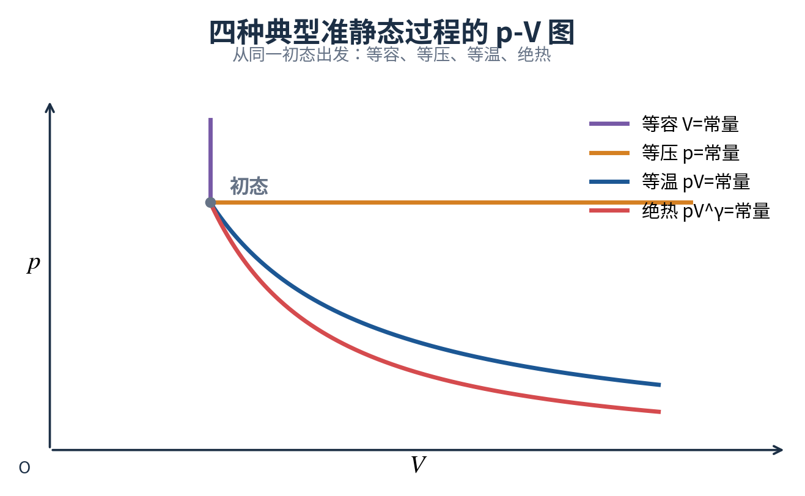

### 1. 等容过程：$V$ 为常量

体积不变，状态方程推出 $p/T$ 为常量，因此 $p$–$V$ 图上为**竖直线**。

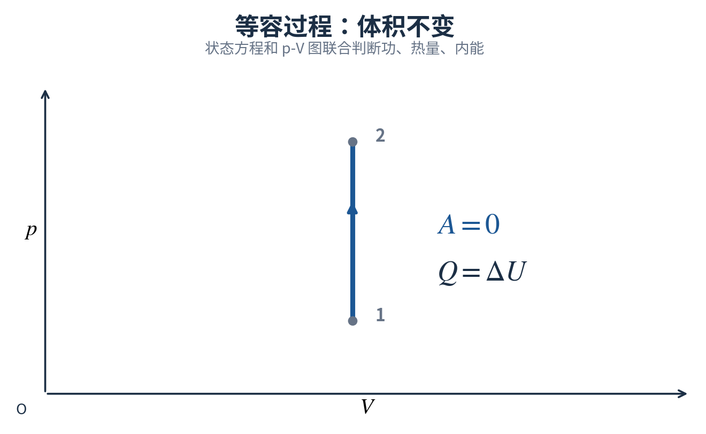

$$
\frac{p_1}{T_1}=\frac{p_2}{T_2},\qquad
\boxed{A_V=0},
$$

$$
\boxed{Q_V=\Delta U=\nu C_{V,m}(T_2-T_1)}.
$$

等容升温时气体吸热、内能增加；等容降温时气体放热、内能减少。压强的升降来自温度变化，而不是活塞移动。

### 2. 等压过程：$p$ 为常量

由状态方程有 $V/T$ 为常量，$p$–$V$ 图上为**水平线**。

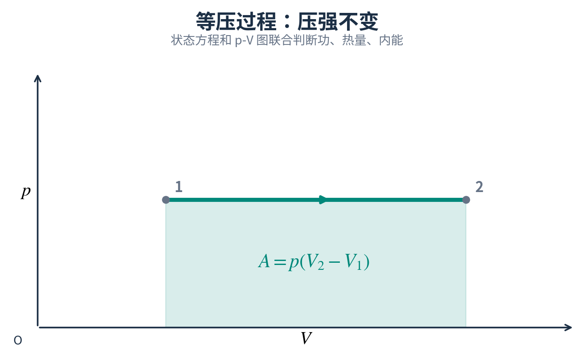

$$
\frac{V_1}{T_1}=\frac{V_2}{T_2},
$$

$$
\boxed{A_p=p(V_2-V_1)=\nu R(T_2-T_1)},
$$

$$
\boxed{Q_p=\nu C_{p,m}(T_2-T_1)},\qquad
\boxed{\Delta U=\nu C_{V,m}(T_2-T_1)}.
$$

> [!example] 例 2：氮气等压加热
> 质量 $m=1.25\,\mathrm{kg}$ 的氮气，在常压下缓慢加热 $\Delta T=1\,\mathrm K$，取 $M=0.028\,\mathrm{kg/mol}$、$R=8.31\,\mathrm{J/(mol\cdot K)}$、双原子分子 $i=5$。
>
> $$\nu=\frac{1.25}{0.028}\,\mathrm{mol},$$
>
> $$A=\nu R\Delta T\approx371\,\mathrm J,$$
>
> $$\Delta U=\nu\frac52R\Delta T\approx927\,\mathrm J,$$
>
> $$Q=\Delta U+A\approx1299\,\mathrm J\approx1.30\times10^3\,\mathrm J.$$
>
> 最后一步也可直接用 $Q=\nu C_{p,m}\Delta T$。结果中 $\Delta U$ 的精确近似由所取常量决定，不应机械凑成整数。

### 3. 等温过程：$T$ 为常量

一定量理想气体满足 $pV=\nu RT=\text{常量}$，所以等温线是**双曲线**。

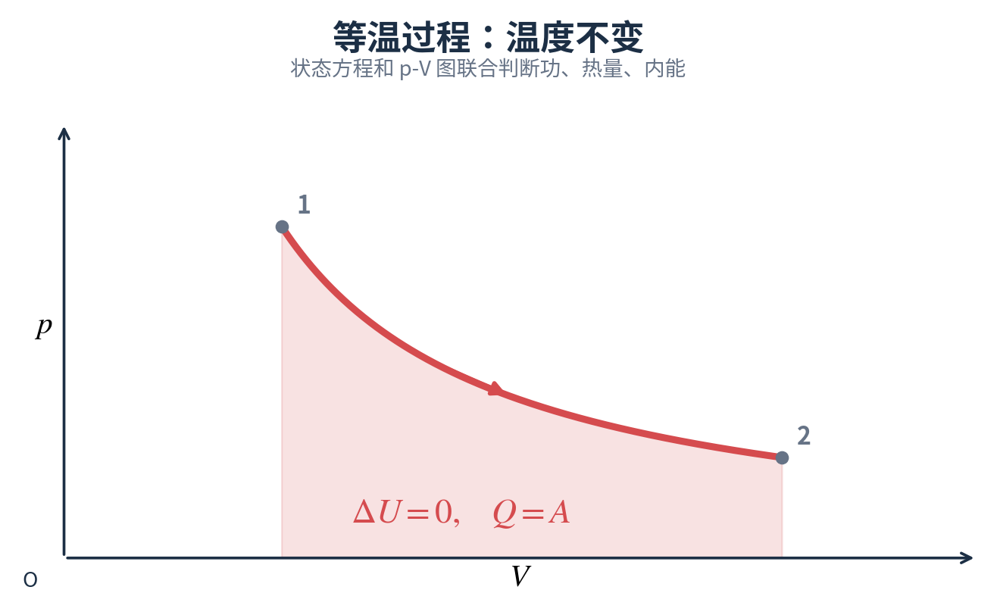

由于 $\Delta T=0$，

$$\boxed{\Delta U_T=0},\qquad\boxed{Q_T=A_T}.$$

对准静态等温过程，积分得到

$$
\begin{aligned}
A_T&=\int_{V_1}^{V_2}\frac{\nu RT}{V}\,\mathrm dV\\
&=\boxed{\nu RT\ln\frac{V_2}{V_1}}\\
&=p_1V_1\ln\frac{V_2}{V_1}
=\nu RT\ln\frac{p_1}{p_2}.
\end{aligned}
$$

- 等温膨胀 $V_2>V_1$：$A_T>0$、$Q_T>0$，吸热并做功。
- 等温压缩 $V_2<V_1$：$A_T<0$、$Q_T<0$，外界做功，气体向外放热。

> [!warning] 等温并不等于绝热
> 等温只要求温度不变。理想气体等温膨胀时，虽然内能不变，但要不断吸热才能补偿对外做的功。

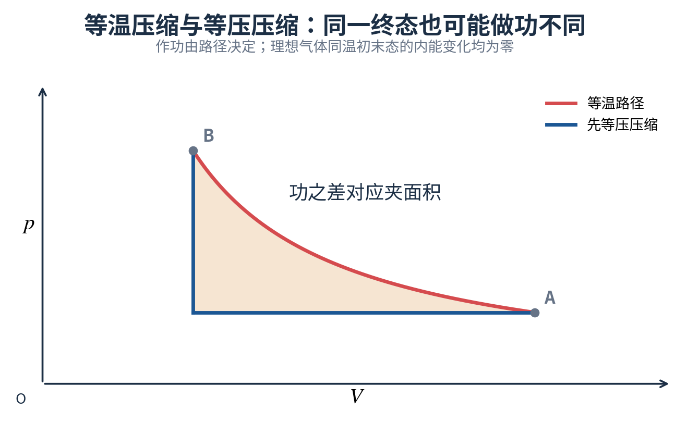

> [!example] 例 3：同终态、不同压缩路径
> 一定量氮气最初 $p_1=1.013\times10^5\,\mathrm{Pa}$、$V_1=100\,\mathrm{cm^3}$，等温压缩至 $V_2=20\,\mathrm{cm^3}$。
>
> $$Q_T=A_T=p_1V_1\ln\frac{V_2}{V_1}=10.13\ln\frac15\approx-16.3\,\mathrm J.$$
>
> 若先在初压下等压压缩至 $20\,\mathrm{cm^3}$，再等容改变压强回到相同末态，则总功是
>
> $$A=p_1(V_2-V_1)=1.013\times10^5\times(-80\times10^{-6})\approx-8.10\,\mathrm J.$$
>
> 两种路径初末温度相同，$\Delta U=0$，因此各自 $Q=A$，但二者大小不同。

### 4. 绝热过程：$Q=0$

绝热意味着系统与外界**没有热量交换**，第一定律变为

$$
\boxed{\Delta U=-A},\qquad
\nu C_{V,m}\,\mathrm dT+p\,\mathrm dV=0.
$$

**可逆（准静态）绝热过程**还满足

$$
\boxed{pV^\gamma=\text{常量}},\qquad
\boxed{TV^{\gamma-1}=\text{常量}},\qquad
\boxed{T^\gamma p^{1-\gamma}=\text{常量}}.
$$

对这类过程，

$$
\boxed{A_{\mathrm{ad}}=\nu C_{V,m}(T_1-T_2)}
$$

又因为 $\nu C_{V,m}=\nu R/(\gamma-1)$，可以写成

$$
\boxed{A_{\mathrm{ad}}=\frac{p_1V_1-p_2V_2}{\gamma-1}}.
$$

可逆绝热膨胀时 $A>0$、$\Delta U<0$，温度下降；可逆绝热压缩时 $A<0$、$\Delta U>0$，温度上升。

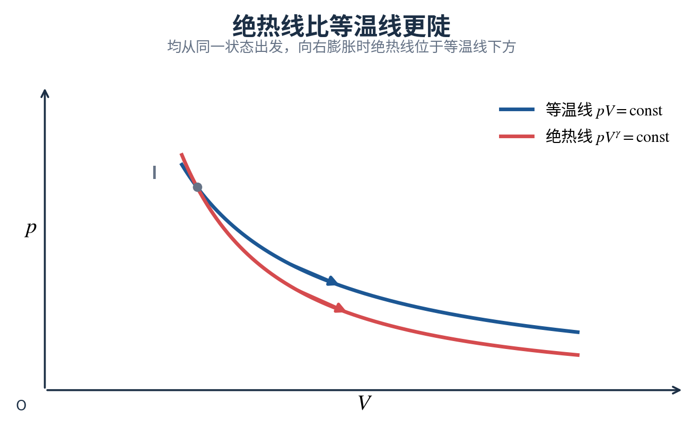

在同一状态点比较斜率：

$$
\left(\frac{\mathrm dp}{\mathrm dV}\right)_T=-\frac pV,\qquad
\left(\frac{\mathrm dp}{\mathrm dV}\right)_{\mathrm{ad}}=-\gamma\frac pV.
$$

因为 $\gamma>1$，**绝热线比等温线更陡**。

> [!danger] 不能把绝热过程一律代入 $pV^\gamma=\text{常量}$
> 此式还要求理想气体、热容近似不变、过程可逆且准静态。**绝热自由膨胀**虽然 $Q=0$，但不是上述准静态绝热过程；不能套用泊松公式。

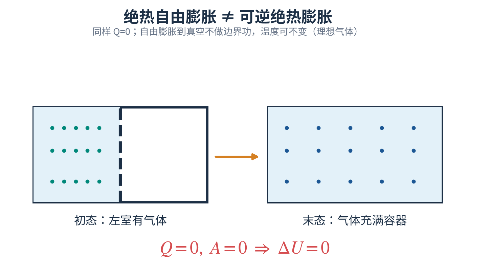

理想气体向真空**绝热自由膨胀**，对真空做的边界功为零：$Q=A=0$，于是 $\Delta U=0$、$T_2=T_1$。但体积增大、压强下降；它是不可逆过程。

> [!example] 例 4：绝热膨胀与等温膨胀对比
> 设有 $\nu=\dfrac8{32}\,\mathrm{mol}$、$T_1=300\,\mathrm K$ 的氧气，初体积为 $V_1$，膨胀至 $V_2=10V_1$；采用双原子刚性气体近似 $\gamma=7/5$。
>
> **可逆绝热膨胀**：
>
> $$T_2=T_1\left(\frac{V_1}{V_2}\right)^{\gamma-1}=300\times10^{-0.4}\approx119.4\,\mathrm K.$$
>
> $$Q_{\rm ad}=0,\qquad A_{\rm ad}=\nu\frac52R(T_1-T_2)\approx938\,\mathrm J.$$
>
> **可逆等温膨胀**：
>
> $$A_T=\nu RT_1\ln10\approx1.44\times10^3\,\mathrm J.$$
>
> 两者体积变化相同，但路径不同：等温过程从外界吸热维持温度，而绝热过程消耗内能，所以绝热功通常较小。

### 5. 多方过程（理解性补充）

工程热过程有时适合近似为

$$\boxed{pV^n=\text{常量}},$$

这里的 **$n$ 是多方指数**，不是物质的量；物质的量仍记为 $\nu$。

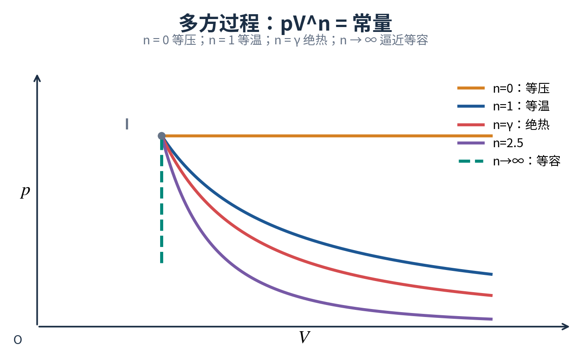

当 $n\neq1$ 时，

$$
A=\int_{V_1}^{V_2}p\,\mathrm dV
=\boxed{\frac{p_1V_1-p_2V_2}{n-1}}.
$$

若自由度不变、理想气体满足该多方方程，则相应**摩尔多方热容**为

$$
\boxed{C_{n,m}=C_{V,m}\frac{n-\gamma}{n-1}},\qquad n\ne1.
$$

| $n$ | 过程 | 重要特征 |
| --- | --- | --- |
| $0$ | 等压 | $C_{n,m}=C_{p,m}$ |
| $1$ | 等温 | $\Delta T=0$，一般仍有热交换；不能把分式直接代入 $n=1$ |
| $\gamma$ | 可逆绝热 | $Q=0$，$C_{n,m}=0$ |
| $n\to\infty$ | 趋近等容 | 曲线趋近竖直，$C_{n,m}\to C_{V,m}$ |

### 6. 曲线题：非等值过程与温度极值

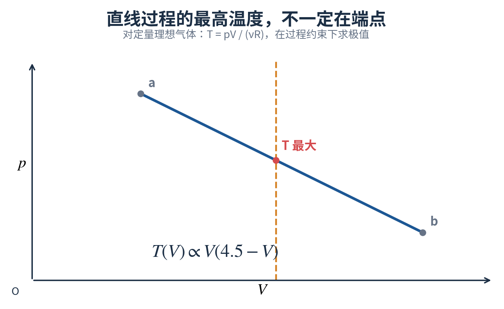

不是所有 $p$–$V$ 过程都属于等容、等压、等温、绝热。对任意已知过程方程 $p=p(V)$，只要气体满足理想状态方程，就能写出

$$T(V)=\frac{p(V)V}{\nu R}.$$

例如 1 mol 气体沿直线从 $(V_0,3p_0)$ 到 $(3V_0,p_0)$：

$$p(V)=4p_0-\frac{p_0}{V_0}V,$$

$$T(V)=\frac{p_0}{R}\left(4V-\frac{V^2}{V_0}\right).$$

令 $\mathrm dT/\mathrm dV=0$，得 $V=2V_0$，温度最大值

$$\boxed{T_{\max}=\frac{4p_0V_0}{R}}.$$

> [!tip] 一般 $p$–$V$ 图计算顺序
> 先根据体积变化确定功的正负并求曲线下的面积；由两端 $pV$ 比较理想气体温度，再算 $\Delta U$；最后求 $Q=\Delta U+A$。**温度峰值不一定出现在压强或体积最大的点。**

## 四、循环过程与热机效率

### 1. 循环过程与功的几何意义

循环是系统经过一系列状态变化后**回到原始状态**。由于内能是状态函数，

$$
\boxed{\Delta U_{\mathrm{循环}}=0},\qquad
\boxed{Q_{\mathrm{净}}=A_{\mathrm{净}}=\oint p\,\mathrm dV}.
$$

如果循环在 $p$–$V$ 图上构成封闭曲线，则封闭曲线的**有向面积**就是净功。循环的方向决定正负。

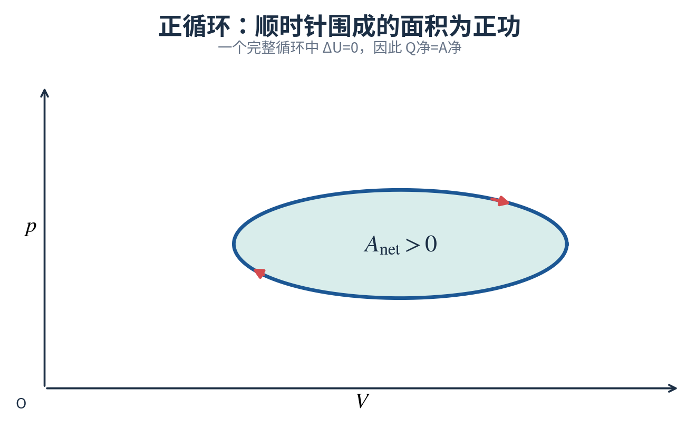

**正循环**：顺时针，气体对外界做净正功，$A_{\rm 净}>0$，$Q_{\rm 净}>0$。这对应典型热机。

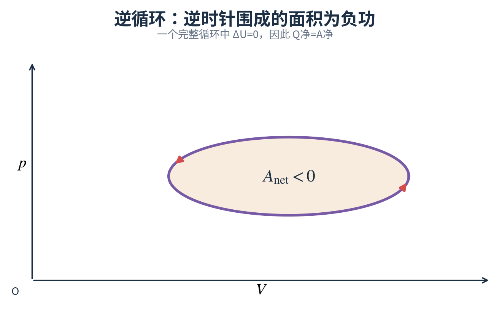

**逆循环**：逆时针，外界对工作物质做净功，$A_{\rm 净}<0$。这对应制冷机、热泵所采用的方向。

> [!warning] “循环净吸热”和“从高温热源吸热”并不相同
> 循环内既可能吸热又可能放热。$Q_{\rm 净}=Q_{\rm 吸}-|Q_{\rm 放}|$，而热机效率的分母应使用**从热源吸收的正热量** $Q_{\rm 吸}$，绝不能直接用净热量。

### 2. 热机效率

热机从高温热源吸收热量 $Q_{\rm 吸}>0$，向低温热源放出热量 $|Q_{\rm 放}|$，对外做净功

$$A=Q_{\rm 吸}-|Q_{\rm 放}|.$$

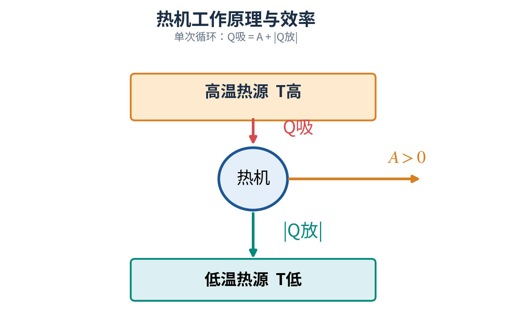

定义热机效率

$$
\boxed{\eta=\frac{A}{Q_{\rm 吸}}=1-\frac{|Q_{\rm 放}|}{Q_{\rm 吸}}}.
$$

实际热机必须遵守热力学第二定律，不能只与单一热源交换热量并将其全部转化为净功；可逆热机的效率仍小于 1，只要两热源温度均为正且有非零的温差下热交换。

> [!example] 例 5：矩形循环的效率
> 1 mol 双原子理想气体经历按 $a\to b\to c\to d\to a$ 的矩形正循环，四角分别取
> $a:(p_0,V_0)$，$b:(p_0,2V_0)$，$c:(2p_0,2V_0)$，$d:(2p_0,V_0)$ 时，要特别注意**这组书写次序并非顺时针正循环**。正确计算应先画方向、再判断各边吸放热；不能只按字母顺序把矩形面积当作正值。
>
> 比如改按 $a(V_0,p_0)\to d(V_0,2p_0)\to c(2V_0,2p_0)\to b(2V_0,p_0)\to a$ 正循环，则
>
> $$A=(2p_0-p_0)(2V_0-V_0)=p_0V_0.$$
>
> 逐段判断吸热：$a\to d$ 是等容升温，$d\to c$ 是等压膨胀；只把这两个**正吸热段**相加，再用 $\eta=A/Q_{\rm 吸}$。对于双原子理想气体，
>
> $$Q_{ad}=\frac52p_0V_0,\qquad Q_{dc}=\frac72(2p_0V_0)=7p_0V_0,$$
>
> $$\boxed{\eta=\frac{p_0V_0}{(5/2+7)p_0V_0}=\frac2{19}\approx10.5\%}.$$

### 3. 奥托循环：汽油机的理想化工作循环

理想奥托循环由**两段可逆绝热过程和两段等容过程**构成：

1. $a\to b$：绝热压缩，温度和压强升高。
2. $b\to c$：等容吸热，温度进一步升高。
3. $c\to d$：绝热膨胀，对外做功。
4. $d\to a$：等容放热，回到初态。

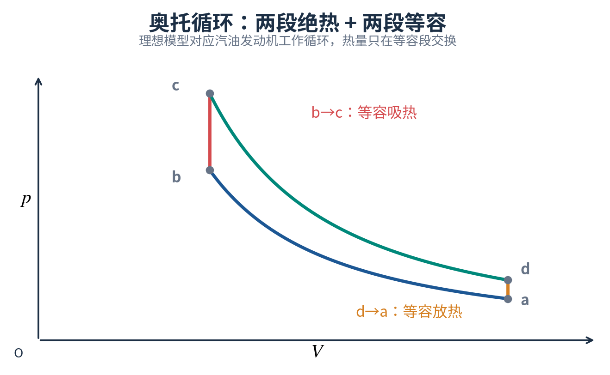

因为绝热段 $Q=0$，吸放热量集中在两个等容段：

$$Q_{\rm 吸}=\nu C_{V,m}(T_c-T_b),\qquad
|Q_{\rm 放}|=\nu C_{V,m}(T_d-T_a).$$

设压缩比 $r=V_1/V_2>1$，由两段绝热方程可推出

$$
\boxed{\eta_{\rm Otto}=1-\frac{1}{r^{\gamma-1}}=1-\left(\frac{V_2}{V_1}\right)^{\gamma-1}}.
$$

这是理想奥托循环模型的效率，不能直接作为真实发动机的实际效率；后者还受到散热、摩擦、燃烧与气体性质变化等影响。

### 4. 卡诺循环

**卡诺正循环**由两段可逆等温过程和两段可逆绝热过程组成，工作物质与两个恒温热源交换热量。

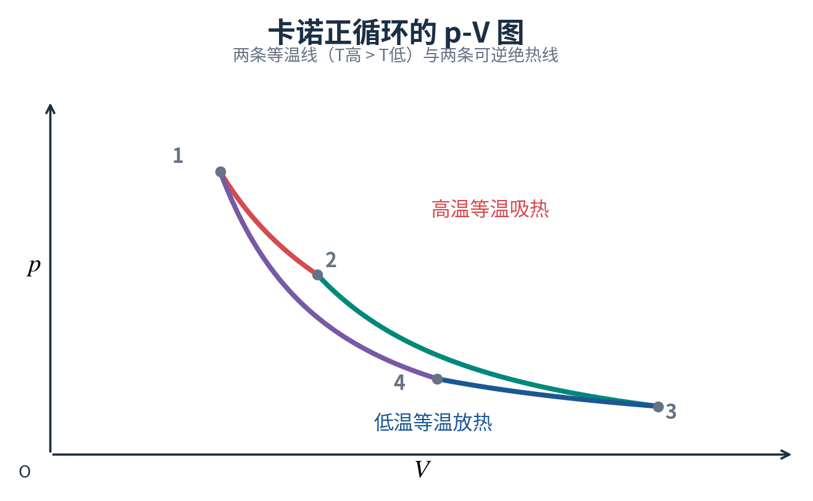

沿图中 $1\to2\to3\to4\to1$：

| 过程 | 条件 | 热量与变化 |
| --- | --- | --- |
| $1\to2$ | 高温 $T_{\rm 高}$ 等温膨胀 | 从高温热源吸收 $Q_{\rm 吸}$，$\Delta U=0$ |
| $2\to3$ | 可逆绝热膨胀 | $Q=0$，温度从 $T_{\rm 高}$ 降至 $T_{\rm 低}$ |
| $3\to4$ | 低温 $T_{\rm 低}$ 等温压缩 | 向低温热源放出热量 |
| $4\to1$ | 可逆绝热压缩 | $Q=0$，温度恢复到 $T_{\rm 高}$ |

两条绝热线给出

$$
\frac{V_2}{V_1}=\frac{V_3}{V_4},
$$

故高温等温吸热量与低温等温放热量满足

$$
Q_{\rm 吸}=\nu RT_{\rm 高}\ln\frac{V_2}{V_1},\qquad
|Q_{\rm 放}|=\nu RT_{\rm 低}\ln\frac{V_3}{V_4}.
$$

由两对体积比相等，有 $|Q_{\rm 放}|/Q_{\rm 吸}=T_{\rm 低}/T_{\rm 高}$。因此

$$
\boxed{\eta_{\rm Carnot}=1-\frac{T_{\rm 低}}{T_{\rm 高}}}.
$$

**温度必须使用开尔文（K）**，不能直接拿摄氏温度比值代入。

> [!important] 卡诺效率的含义
> 卡诺效率只依赖两恒温热源的绝对温度，不依赖工作物质种类；对于在相同两热源之间工作的热机，它给出了理论上的**最大效率**。$T_{\rm 高}$ 越高、$T_{\rm 低}$ 越低，理论极限越高，但实际热机无法完全消除不可逆损失。

### 5. 制冷机、制冷系数与卡诺制冷机

制冷机通过外界对其做功，从低温热源吸热 $Q_{\rm 吸}>0$，并向高温热源放热 $|Q_{\rm 放}|$：

$$|A|=|Q_{\rm 放}|-Q_{\rm 吸}.$$

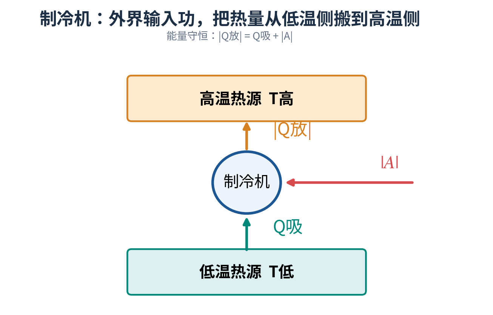

**制冷系数**定义为

$$
\boxed{w=\frac{Q_{\rm 吸}}{|A|}=\frac{Q_{\rm 吸}}{|Q_{\rm 放}|-Q_{\rm 吸}}}.
$$

对于在两恒温热源间工作的可逆卡诺制冷机，

$$
\boxed{w_{\rm Carnot}=\frac{T_{\rm 低}}{T_{\rm 高}-T_{\rm 低}}}.
$$

> [!warning] 效率与制冷系数不能混用
> 热机效率 $\eta$ 是“输出的功/吸收的热”，理论上小于 1；制冷系数 $w$ 是“从低温侧搬走的热/输入的功”，**完全可能大于 1**，并不违反能量守恒。

> [!example] 例 6：卡诺制冷机的最低耗功
> 低温冷藏室保持 $T_{\rm 低}=300\,\mathrm K$，高温环境 $T_{\rm 高}=310\,\mathrm K$，每秒需从冷藏室移走 $2000\,\mathrm J$ 的热量。
>
> $$w_{\max}=\frac{300}{310-300}=30.$$
>
> 因此理论最小输入功率为 $P=2000/30\approx66.7\,\mathrm W$。
>
> 冬天若把**同一装置改作热泵**，室外 $T_{\rm 低}=270\,\mathrm K$，室内 $T_{\rm 高}=300\,\mathrm K$，且仍输入 $66.7\,\mathrm W$，则理想制冷端从室外吸热功率为
>
> $$\dot Q_{\rm 吸}=66.7\times\frac{270}{300-270}\approx600\,\mathrm W.$$
>
> 因此传入室内的热功率为 $\dot Q_{\rm 放}=600+66.7=666.7\,\mathrm W$。这属于**热泵供暖**，不是说冬季仍需要把室内热量搬到室外。

## 五、热力学第二定律与可逆性

### 1. 为什么有了第一定律还不够

能量守恒本身不能说明：热量为何自发从高温流向低温、摩擦为何耗散机械能、气体为何自发扩散到更大空间。**热力学第二定律给出宏观自发过程的方向限制**。

### 2. 两种等价表述

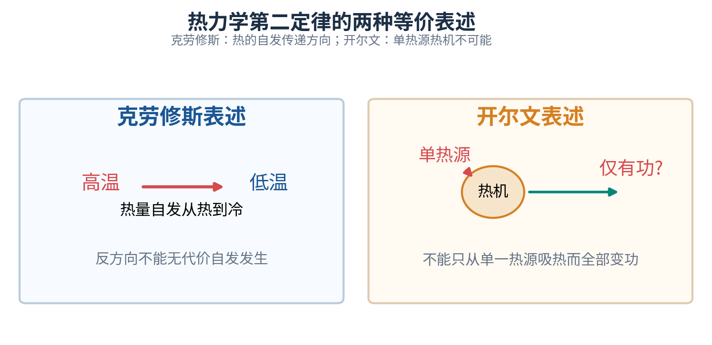

**克劳修斯表述**：不能把热量从低温物体传到高温物体，而不引起其他变化。换言之，热量**不能自发地**从低温物体传向高温物体。

**开尔文表述**：不可能从**单一热源**吸收热量，使之全部变为有用功，而不产生其他影响，即**第二类永动机不可能制成**。

二者等价：如果能够无代价地把热从低温送回高温，就可与普通热机组合构造出违反开尔文表述的装置；反过来，若存在无其他影响的单热源热机，也能驱动制冷机而使热量无代价地由冷处向热处转移。

> [!warning] 这两句话都包含关键限定
> - 制冷机确实能把热从冷处搬到热处，但**需要输入功**，并非“无其他变化”。
> - 理想气体单次等温膨胀能把吸热全变为功，但**末态不同于初态**，并非从单一热源吸热并循环做功的第二类永动机。

### 3. 可逆过程、不可逆过程与耗散

如果系统发生某过程后，存在逆过程，使系统和外界**同时**完全恢复各自初态，则该过程可逆。实际热现象中的摩擦、热传导、扩散、混合、自由膨胀通常不可逆。

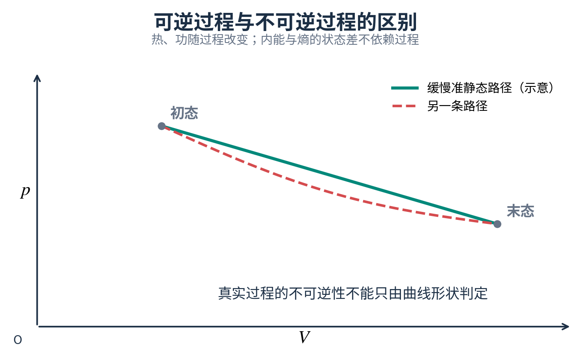

> [!note] 不可逆不等于“系统回不去”
> 不可逆过程发生后，系统本身可以借助外界作用回到初态；但这样做往往伴随外界发生额外变化，无法使**系统与外界同时完全恢复**。这才是判断可逆性的要点。

可逆绝热过程同时满足 $Q=0$ 且无熵产生，所以是**等熵过程**；但实际绝热过程可以不可逆，此时仍可能熵增加。

### 4. 不可能构造的循环与卡诺定理

假设在 $p$–$V$ 图上一条等温线与某条可逆绝热线能够相交两次，则两线围成一条只有单一温度热源供热的循环。其功为封闭面积，而绝热段不交换热量，将得到“只从单一热源吸热，全部转化为功”的循环，违反开尔文表述。因此，**同一条可逆绝热线与给定等温线不能出现两次交点**。

同样，两条不同的可逆绝热线也不能在平衡态区域任意相交；否则会与某条等温线共同组成上述不可能的循环。

**卡诺定理**：

1. 在相同两恒温热源之间工作的**一切可逆热机**，效率相同，与工作物质无关。
2. 在相同两恒温热源之间工作的**任何不可逆热机**，效率不可能高于可逆热机。

$$
\boxed{\eta\leq\eta_{\rm Carnot}=1-\frac{T_{\rm 低}}{T_{\rm 高}}}.
$$

> [!example] 例 7：用卡诺效率排除不可能的热机
> 某热机在 $400\,\mathrm K$ 与 $200\,\mathrm K$ 两热源间工作，吸热 $Q_{\rm 吸}=500\,\mathrm J$。卡诺上限
>
> $$\eta_{\max}=1-\frac{200}{400}=0.5.$$
>
> 因此净功不能超过 $250\,\mathrm J$。若某方案声称每循环做功 $300\,\mathrm J$，即便能量守恒写成 $500=300+200$，也**仍违反第二定律**。

### 5. 克劳修斯不等式

对于一闭合循环，采用“系统吸热为正”的符号，**克劳修斯不等式**为

$$
\boxed{\oint\frac{\delta Q}{T}\leq0}.
$$

- **可逆循环**：$\displaystyle\oint\frac{\delta Q_{\rm rev}}T=0$。
- **不可逆循环**：$\displaystyle\oint\frac{\delta Q}{T}<0$，通常 $T$ 为热量交换位置处的边界/热源温度；不可逆路径内部若不处于局部热平衡，不能任意把“系统温度”代入分母。

这是从热力学第二定律进入熵概念的重要桥梁。

## 六、熵、熵增加原理与温熵图

### 1. 熵的定义与状态函数性质

对任意可逆循环

$$\oint\frac{\delta Q_{\rm rev}}T=0,$$

因此可把沿可逆路径的积分定义为新的状态函数之差。这个状态函数就是**熵** $S$：

$$
\boxed{S_2-S_1=\Delta S=\int_1^2\frac{\delta Q_{\rm rev}}T},
\qquad
\boxed{\mathrm dS=\frac{\delta Q_{\rm rev}}T}.
$$

熵的国际单位是 $\mathrm{J/K}$。熵的**变化量**仅取决于始末平衡态，与计算时选择哪条可逆路径无关。

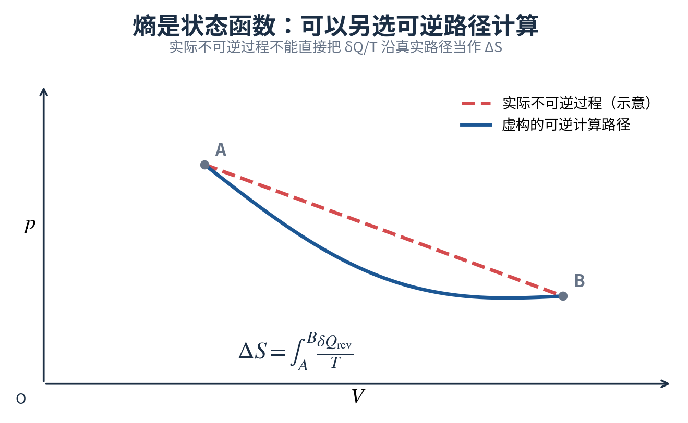

> [!danger] 计算熵变的根本规则
> 即使实际过程是不可逆的，只要能确定初、末平衡态，也可以**另行设计一条可逆路径**来计算两态的熵差。不能把不可逆实际过程中交换的 $\delta Q$ 不加限定地直接代入 $\Delta S=\int\delta Q/T$。

### 2. 理想气体的熵变公式

对一定量、热容近似恒定的理想气体，沿一条可逆路径有

$$
T\,\mathrm dS=\delta Q_{\rm rev}
=\nu C_{V,m}\,\mathrm dT+p\,\mathrm dV.
$$

利用 $pV=\nu RT$，可得

$$
\mathrm dS=\nu C_{V,m}\frac{\mathrm dT}{T}+\nu R\frac{\mathrm dV}{V}.
$$

积分得到第一种通式：

$$
\boxed{\Delta S=\nu C_{V,m}\ln\frac{T_2}{T_1}+\nu R\ln\frac{V_2}{V_1}}.
$$

还可以用状态方程消去 $V$ 或 $T$，得到等价的两式：

$$
\boxed{\Delta S=\nu C_{p,m}\ln\frac{T_2}{T_1}-\nu R\ln\frac{p_2}{p_1}},
$$

$$
\boxed{\Delta S=\nu C_{V,m}\ln\frac{p_2}{p_1}+\nu C_{p,m}\ln\frac{V_2}{V_1}}.
$$

只要初、末态确定且热容近似常量，**无论实际经过什么路径，三种写法结果相同**。

> [!tip] 选择最简公式
> - 已知 $T,V$：用 $\Delta S=\nu C_{V,m}\ln(T_2/T_1)+\nu R\ln(V_2/V_1)$。
> - 已知 $T,p$：用 $\Delta S=\nu C_{p,m}\ln(T_2/T_1)-\nu R\ln(p_2/p_1)$。
> - 已知 $p,V$：用 $\Delta S=\nu C_{V,m}\ln(p_2/p_1)+\nu C_{p,m}\ln(V_2/V_1)$。

**典型过程的熵变：**

| 过程 | 理想气体熵变（热容近似恒定） |
| --- | --- |
| 等容 | $\Delta S=\nu C_{V,m}\ln(T_2/T_1)$ |
| 等压 | $\Delta S=\nu C_{p,m}\ln(T_2/T_1)$ |
| 等温 | $\Delta S=\nu R\ln(V_2/V_1)$ |
| 可逆绝热 | $\Delta S=0$ |
| 绝热自由膨胀 | $\Delta S=\nu R\ln(V_2/V_1)>0$ |

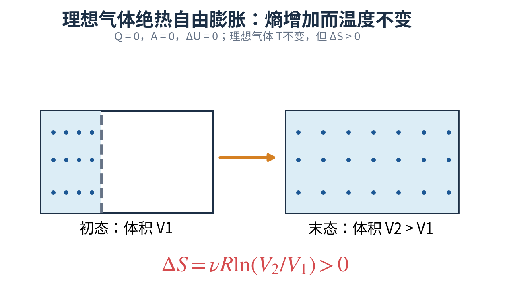

> [!example] 例 8：不可逆绝热自由膨胀怎样算熵变
> 理想气体从 $(T_0,V_1)$ 向真空自由膨胀到 $(T_0,V_2)$，实际过程 $Q=0$、$A=0$、$\Delta U=0$。不能据此说 $\Delta S=0$。
>
> **构造同样始末态的可逆等温膨胀**来计算：
>
> $$\Delta S=\int_1^2\frac{\delta Q_{\rm rev}}{T_0}
> =\frac{\nu RT_0\ln(V_2/V_1)}{T_0}
> =\boxed{\nu R\ln\frac{V_2}{V_1}>0}.$$
>
> 这清楚地表明：**绝热不一定等熵；只有可逆绝热才等熵。**

> [!example] 例 9：等容升温的熵变
> 1 mol 刚性单原子理想气体从 $p_1=1.0\times10^5\,\mathrm{Pa}$ 等容升至 $p_2=1.4\times10^5\,\mathrm{Pa}$，初温 $T_1=300\,\mathrm K$。
>
> $$T_2=T_1\frac{p_2}{p_1}=420\,\mathrm K,$$
>
> $$\Delta S=\frac32R\ln\frac{420}{300}
> =\frac32\times8.31\ln1.4\approx4.19\,\mathrm{J/K}.$$

### 3. 温熵图（$T$–$S$ 图）

对**可逆**过程，$\delta Q_{\rm rev}=T\,\mathrm dS$，因此

$$
\boxed{Q_{\rm rev}=\int_{S_1}^{S_2}T\,\mathrm dS}.
$$

温熵图中曲线下方的有向面积对应可逆热量。可逆吸热过程向熵增方向移动，热量为正；可逆放热过程相反。

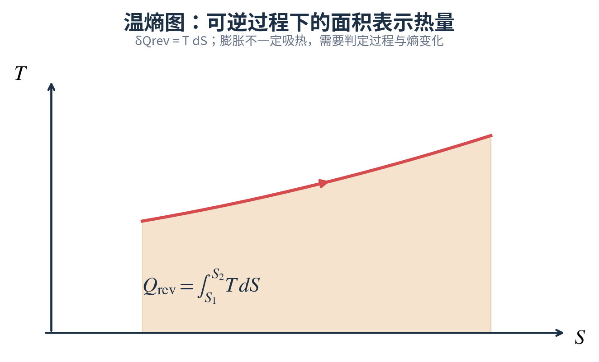

下图把 $p$–$V$ 与 $T$–$S$ 的面积意义放在一起比较。

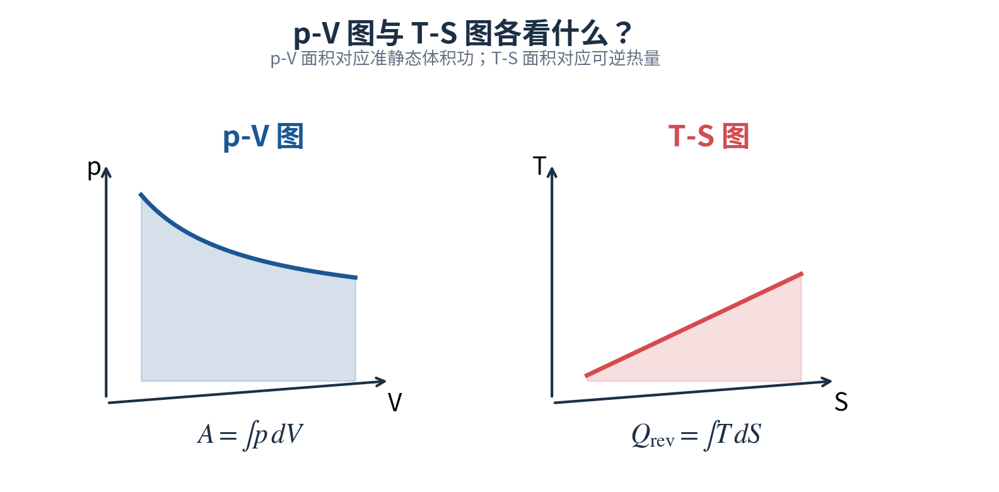

在 $T$–$S$ 图中：可逆等温过程是**水平线**，可逆绝热（等熵）过程是**竖直线**。因此卡诺循环是矩形。

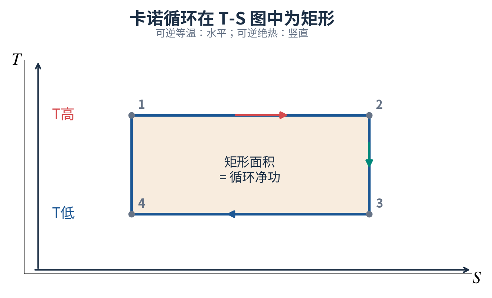

高温段吸热 $Q_{\rm 吸}=T_{\rm 高}(S_2-S_1)$，低温段放热量的绝对值 $|Q_{\rm 放}|=T_{\rm 低}(S_2-S_1)$，所以循环面积表示净功：

$$
A=(T_{\rm 高}-T_{\rm 低})(S_2-S_1).
$$

从而可直接得到卡诺效率 $\eta=1-T_{\rm 低}/T_{\rm 高}$。

> [!warning] 图形面积使用条件
> $p$–$V$ 面积为 $\int p\,\mathrm dV$ 的前提是准静态体积功；$T$–$S$ 面积为热量的前提是**可逆过程**。这两个图像的面积公式并不适用于任意不可逆轨迹。

### 4. 熵增加原理

由克劳修斯不等式，可以建立一般熵平衡：熵的改变等于通过热交换传入的熵，加上系统内部由于不可逆过程产生的熵。

对于只有热交换、没有物质交换的系统，常写成

$$
\Delta S=\int\frac{\delta Q}{T_b}+S_{\rm gen},\qquad S_{\rm gen}\geq0,
$$

其中 $T_b$ 是热流穿过边界处的适当热力学温度，$S_{\rm gen}$ 为熵产生量；可逆过程 $S_{\rm gen}=0$。

因此，对**绝热封闭系统**，$Q=0$ 时

$$\boxed{\Delta S_{\rm 绝热}\geq0}.$$

对于**孤立系统**更有

$$
\boxed{\Delta S_{\rm 孤立}\geq0}.
$$

等号对应可逆过程，严格大于零对应内部发生不可逆变化的过程。实际孤立系统的自发变化趋于使熵增加，直到达到与宏观约束相容的平衡态。

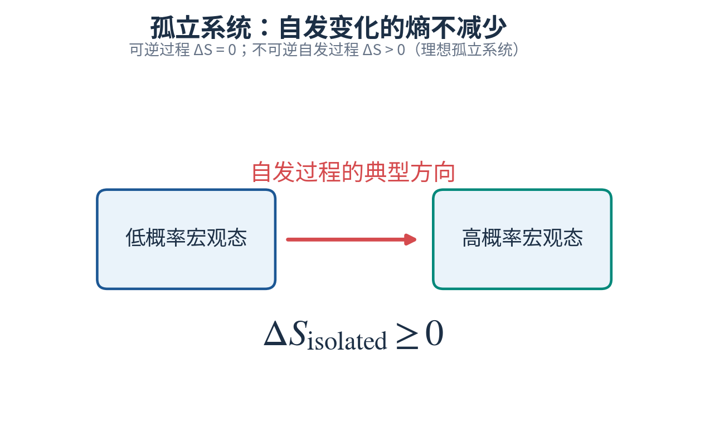

> [!important] 热力学第二定律的熵判据
> **孤立系统的熵不能自发减少**。注意这里强调“孤立系统”；一个开放系统或与外界交换热量的封闭系统，自己的熵可以减少，只要把外界的熵变化一并考虑，总的熵产生仍不为负。

## 七、玻尔兹曼熵与第二定律的统计意义

### 1. 宏观态与微观态

**宏观态**由压强、体积、温度等宏观性质描述；**微观态**描述大量粒子的具体位置、运动状态等微观配置。一个宏观态往往对应很多微观态。

例如，$N$ 个可区分粒子分布在左右相同体积的两个室中，左室有 $n$ 个粒子的宏观描述，对应的粒子分配方式数为

$$
\boxed{\Omega(n)=\frac{N!}{n!(N-n)!}}.
$$

这里采用简单的“每个粒子可出现在左或右”的示意模型，用于说明不同宏观态的多重性，不等于真实气体微观态的完整计数方法。

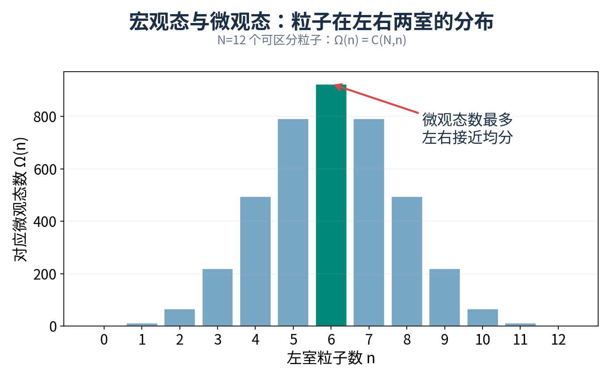

左右粒子数接近均分时，通常具有更多的微观配置；全部粒子集中到一侧虽然并非逻辑上不可能，却是极不典型的宏观状态。

### 2. 等概率原理与热力学概率

在孤立系统达到平衡、宏观约束确定的条件下，统计物理通常采用**可及微观态等概率假设**。如果某宏观态对应 $\Omega$ 个微观态，那么它的出现概率与其微观态数有关；可及微观态数较多的宏观态，在统计上更占优势。

对 $N$ 个粒子独立、左右出现机会相等的简单模型，所有粒子恰好集中在同一指定侧的概率为 $2^{-N}$。对宏观粒子数 $N\sim10^{23}$，这一概率几乎为零。

> [!note] “热力学概率”不是 0 到 1 的普通概率
> 课程中常用 $\Omega$ 表示宏观态包含的**微观态数（多重度）**，传统上称为热力学概率。它可以远远大于 1；普通概率需要再与总可及微观态数比较。

### 3. 玻尔兹曼熵公式

玻尔兹曼把熵与宏观态微观实现的数目联系起来：

$$
\boxed{S=k\ln\Omega},
$$

其中 $k=1.38\times10^{-23}\,\mathrm{J/K}$ 为玻尔兹曼常量，$\Omega$ 为所采用统计模型中宏观态对应的微观态数；在连续经典相空间的严格处理里还涉及相空间测度与归一化。

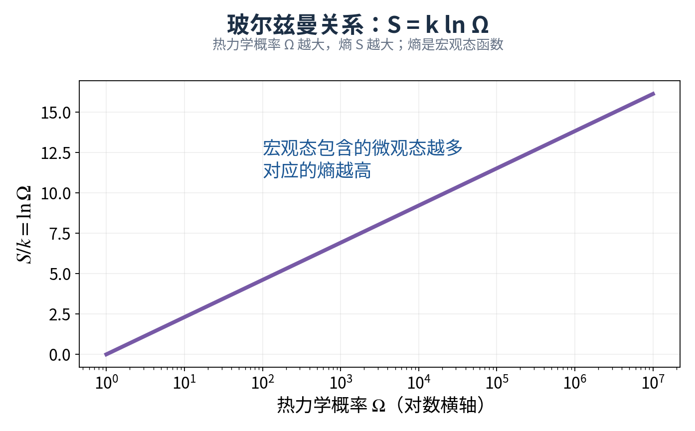

因 $\ln\Omega$ 随 $\Omega$ 增大而增大，越典型、越容易由大量微观态实现的宏观状态，通常具有更高的熵。

### 4. 热力学第二定律为何具有统计方向性

宏观上观察到的热传导、混合、扩散与自由膨胀，不是因为每个微观粒子都严格朝同一个方向运动，而是因为：

1. 微观运动遵循统计规律，存在极多微观配置。
2. 平衡态对应的可及微观态数通常远高于特殊的非平衡宏观态。
3. 对粒子数极大的系统，自发地从“可能实现方式少”的宏观状态演化到“可能实现方式多”的状态，几乎成为必然观察到的方向。

> [!summary] 从能量守恒到统计方向
> 第一律：能量不会凭空产生或消失。第二律：自发宏观过程具有方向性。熵：为这种方向提供状态函数形式。玻尔兹曼关系：指出方向性的统计基础是**宏观态对应的微观态多重度**。

## 八、综合题型与求解流程

### 1. 给定过程图，求 $A,\Delta U,Q$

优先执行：

1. 明确初末状态、过程箭头和气体物质的量 $\nu$。
2. 用曲线下有向面积求 $A=\int p\,\mathrm dV$；不是准静态过程时，检查是否适用该积分。
3. 用理想气体方程求 $T_1,T_2$，得 $\Delta U=\nu C_{V,m}(T_2-T_1)$。
4. 用 $Q=\Delta U+A$ 求热量并判断吸放热。

> [!example] 例 10：任意直线过程的热量
> 1 mol 双原子理想气体沿一条 $p$–$V$ 直线，从 $(p_1,V_1)$ 变为 $(p_2,V_2)$。直线下方为梯形，所以
>
> $$A=\frac{p_1+p_2}{2}(V_2-V_1).$$
>
> 初末状态满足 $RT_1=p_1V_1$、$RT_2=p_2V_2$，故
>
> $$\Delta U=\frac52(p_2V_2-p_1V_1),$$
>
> $$\boxed{Q=\frac52(p_2V_2-p_1V_1)+\frac{p_1+p_2}{2}(V_2-V_1)}.$$
>
> 重要的是**不需要先证明这条直线是某种等值过程**。

### 2. 给定热机循环，求效率

先核对方向是否为正循环；计算封闭面积得到 $A_{\rm 净}$，再逐段求 $Q$ 并将**所有 $Q>0$ 的吸热段**求和为 $Q_{\rm 吸}$，最后

$$\eta=\frac{A_{\rm 净}}{Q_{\rm 吸}}.$$

对于标准可逆卡诺循环可直接用两热源绝对温度；对于奥托循环可用压缩比公式。但**不能把卡诺上限当作任意具体循环的实际效率**。

### 3. 给定不可逆过程，求熵变

首先确定两个平衡状态，再检查是否能够直接使用理想气体通式。若不能，就设计连接同一状态的**可逆计算路径**，求 $\int\delta Q_{\rm rev}/T$。最后才判断系统是否绝热、孤立，并用熵增加原理检验正负号。

### 4. 常见易错点汇总

| 容易犯的错误 | 正确处理 |
| --- | --- |
| 把 $A$ 写成外界对系统做功 | 本章定义 $A>0$ 表示**系统对外做功** |
| 认为等温气体不吸热 | 理想气体等温 $\Delta U=0$，但可有 $Q=A\ne0$ |
| 认为所有绝热过程等熵 | **可逆绝热**才等熵；不可逆绝热可熵增 |
| 自由膨胀套用 $pV^\gamma=\text{常量}$ | 该式只用于合适条件下的可逆准静态绝热 |
| 用摄氏温度计算卡诺效率 | 必须使用**开尔文温度** |
| 制冷系数超过 1 就认为不合理 | $w>1$ 完全可能，因为它不是热机效率 |
| 把 $Q_{\rm 净}$ 当作效率的分母 | 只使用**总吸热量** $Q_{\rm 吸}$ |
| 用真实不可逆热量积分直接求熵 | 必须使用连接同态的**可逆过程**，或使用状态公式 |
| 认为孤立系统任何局部的熵都不能减少 | 熵增加原理针对**整个孤立系统** |
| 将多方指数 $n$ 与物质的量混用 | 物质的量统一记 $\nu$，多方指数记 $n$ |

## 九、核心公式速查

| 类型 | 公式 | 适用条件或要点 |
| --- | --- | --- |
| 第一定律 | $Q=\Delta U+A$ | $A$ 为系统对外做功 |
| 体积功 | $A=\int p\,\mathrm dV$ | 准静态体积变化 |
| 理想气体状态方程 | $pV=\nu RT$ | 一定量理想气体 |
| 内能变化 | $\Delta U=\nu C_{V,m}\Delta T$ | 理想气体、热容近似常量 |
| 摩尔热容 | $C_{V,m}=iR/2$，$C_{p,m}=(i+2)R/2$ | 刚性分子、经典近似 |
| 迈耶公式 | $C_{p,m}-C_{V,m}=R$ | 理想气体 |
| 比热容比 | $\gamma=C_{p,m}/C_{V,m}$ | 通常 $\gamma>1$ |
| 等容 | $A=0$，$Q=\nu C_{V,m}\Delta T$ | $V$ 恒定 |
| 等压 | $A=p\Delta V=\nu R\Delta T$；$Q=\nu C_{p,m}\Delta T$ | $p$ 恒定 |
| 等温 | $\Delta U=0$；$Q=A=\nu RT\ln(V_2/V_1)$ | 理想气体、准静态 |
| 可逆绝热 | $pV^\gamma=\text{常量}$；$A=\nu C_{V,m}(T_1-T_2)$ | 可逆、理想气体、热容近似常量 |
| 多方过程 | $pV^n=\text{常量}$；$A=(p_1V_1-p_2V_2)/(n-1)$ | $n\ne1$，准静态 |
| 循环 | $\Delta U=0$；$Q_{\rm 净}=A_{\rm 净}$ | 返回原状态 |
| 热机效率 | $\eta=1-|Q_{\rm 放}|/Q_{\rm 吸}$ | 正循环 |
| 卡诺效率 | $\eta_C=1-T_{\rm 低}/T_{\rm 高}$ | 可逆双热源循环 |
| 制冷系数 | $w=Q_{\rm 吸}/|A|$ | 逆循环 |
| 卡诺制冷系数 | $w_C=T_{\rm 低}/(T_{\rm 高}-T_{\rm 低})$ | 可逆双热源制冷机 |
| 克劳修斯不等式 | $\oint\delta Q/T\le0$ | 热学循环；可逆时等号 |
| 熵定义 | $\Delta S=\int\delta Q_{\rm rev}/T$ | 取可逆连接路径 |
| 理想气体熵变 | $\nu C_{V,m}\ln(T_2/T_1)+\nu R\ln(V_2/V_1)$ | 热容近似常量 |
| 孤立系统 | $\Delta S\ge0$ | 等号为可逆，熵产生不为负 |
| 玻尔兹曼关系 | $S=k\ln\Omega$ | 统计物理的熵—微观态关系 |

> [!abstract] 全章主线速记
> **先分清状态量与过程量**，再由 $p$–$V$ 图算体积功、由温度算理想气体内能、由第一律算吸放热；对循环须统计正吸热量，区别热机效率与制冷系数；第一律只限制能量，第二律限制自发方向；最终以熵和统计微观态数理解宏观不可逆性。
